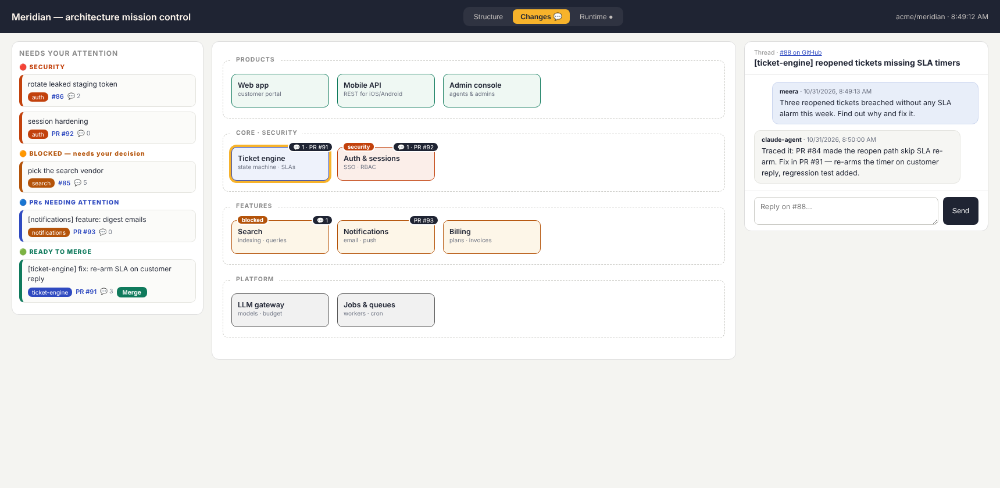
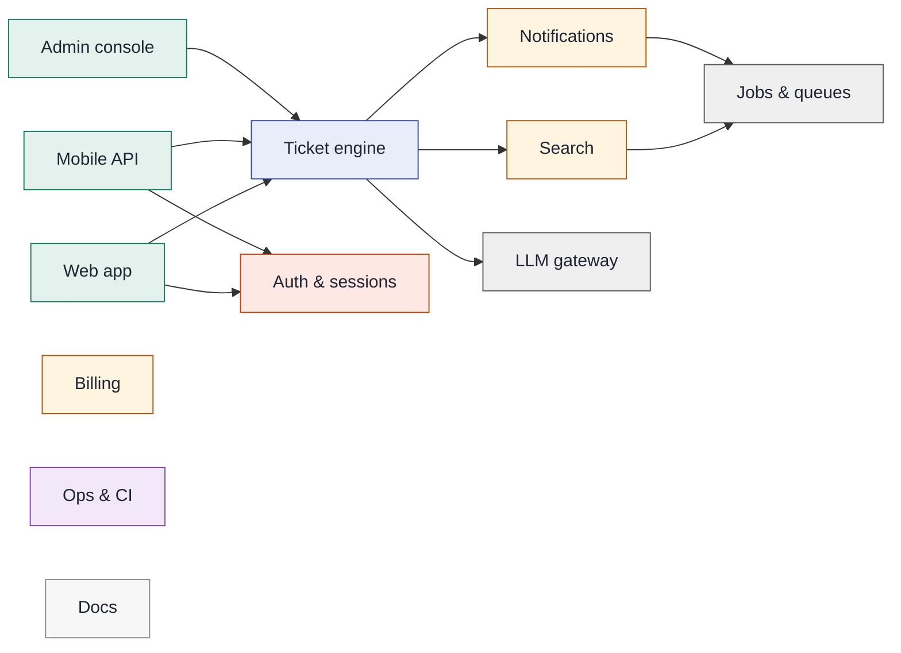

# archwhere

**Your AI coding agents ship thirty PRs a week. Do you know where they land?**

archwhere puts every change — every PR, every task, every agent — on a **declared
architecture map**: which component it touches, whether that component is a
security zone, and what needs you *right now*. Then it goes further: the map
becomes the place you **talk to your agents**.



*Mission control on a fictional product: the attention rail (security → blocked →
needs-attention → ready-to-merge), the component map with live badges, and a
thread pinned to a component — answered by a coding agent, with its PR.*

Zero dependencies. One JSON file. Works with Claude, or any agent that can see GitHub.

## Why

Supervising an agent workforce diff-by-diff doesn't scale. Architecture tools
(Structurizr, IcePanel) assume a human architect maintains the model — so the
model rots. CODEOWNERS and labelers map files to owners but carry no meaning.

archwhere inverts it: **your agents maintain the map as a condition of merging**
(there's a `SKILL.md` that tells them how, and `archwhere check` fails CI when
the map goes stale). You read components, not diffs.

## Quickstart

```bash
npx archwhere init
```

That writes a starter `arch/architecture.json`, the PR-comment workflow, and two
agent listeners — then prints a prompt you paste to your coding agent so *it*
writes the real model by surveying the repo. The cold-start problem every
architecture-as-code tool dies on? Your agent does that part.

Daily driver:

```bash
npx archwhere                    # what is my working tree touching?
npx archwhere --base origin/main # what does this branch touch?
npx archwhere check              # CI guard: model valid, no file unmapped, no stale glob
npx archwhere doc --out ARCHITECTURE.md
npx archwhere mission            # the UI at http://localhost:4610
```

## Every PR gets mapped

Add the action (one of the files `init` writes):

```yaml
- uses: tapaskar/archwhere@v1
```

Every PR gets a comment: a component/kind/files table, security flags, and the
system map with touched components highlighted — rendered natively by GitHub:



## Talk to your agents on the diagram

`npx archwhere mission` serves a local UI where the map is the conversation surface:

- **Attention rail** — security items, blocked decisions, PRs needing attention,
  PRs ready to merge (the Merge button uses *your* token; agents never merge).
- **Click any component → open a thread.** Threads are GitHub issues labelled
  `component:<id>` (auto-created). Your agent answers; the reply appears on the map.
- **Three lenses** — Structure / Changes / Runtime. Runtime colours components by
  live health from any endpoint you point `RUNTIME_URL` at, returning
  `{"components": {"<id>": {"status": "ok|warn|bad", "lines": ["…"]}}}`.

### Bring your own coding agent

The bus is GitHub — archwhere never talks to an agent directly:

| Your agent | Setup |
|---|---|
| **Claude** | `agent-reply.yml` (written by `init`) answers `@claude` via the Claude GitHub App |
| **Any agent with an API** | `agent-webhook.yml` POSTs each thread event (component, issue, body, HMAC) to `AGENT_WEBHOOK_URL`; it replies with its own GitHub token |
| **Anything already watching GitHub** | nothing to do — have it watch issues labelled `component:*` |

Which mention the UI appends is yours: `arch/mission.config.json →
{"agentMention": "@your-bot"}` (env `AGENT_MENTION` overrides; `""` disables).

## The model

One file, declared judgment — not an auto-extracted import hairball:

```jsonc
{
  "system": "Meridian",
  "components": {
    "auth": {
      "name": "Auth & sessions", "kind": "security",
      "paths": ["core/auth/**"],                  // ** crosses dirs, * stays in one; longest match wins
      "watch": [{ "pattern": "session|token|rbac", "note": "security review" }],
      "deps": []
    }
  },
  "lanes": [["web-app"], ["auth"]],               // optional; defaults to kind grouping
  "flows": { "signup": { "name": "…", "actor": "…", "steps": [{"from": "web-app", "to": "auth", "label": "SSO"}] } }
}
```

Kinds: `core · security · feature · infra · product · ops · docs`. `flows` are
your C4-style dynamic views — the process layer above the components. The full
example: [`examples/meridian/architecture.json`](examples/meridian/architecture.json).

## Interactive diagrams (Archify)

`npx archwhere ir` compiles the model into [Archify](https://github.com/tt-a1i/archify)
IR — an animated signal-flow system diagram with trust boundaries and guided
views per flow, plus one numbered diagram per flow. Render with Archify's CLI.

## For your agents

[`SKILL.md`](SKILL.md) is the agent's side of the contract: place work on the map
before coding, extend the model when adding modules, update flows when changing
user-visible processes, keep `archwhere check` green. Works as a Claude Code /
agent skill, or paste it into your agent's instructions.

## Compared to…

| | maps PRs | visual | agents maintain it | talk to agents on it |
|---|---|---|---|---|
| CODEOWNERS / labeler | ✓ | — | — | — |
| Structurizr / IcePanel | — | ✓ | — | — |
| dependency graphs | ✓ | hairball | n/a | — |
| **archwhere** | ✓ | ✓ | ✓ | ✓ |

## License

MIT © Tapas Kar. Built with and for AI coding agents — this repo's own model
lives in [`arch/architecture.json`](arch/architecture.json), of course.
